# Vessel

**Track, listen to and talk through satellites, all from one native macOS app.**

Vessel brings together three jobs that usually need three separate programs: tracking where a satellite is and when it passes over you, tuning a software-defined radio to hear it, and decoding what it sends. It also lets licensed amateurs transmit through public amateur satellites. Pick a satellite on the globe, and Vessel works out the pass, tunes your radio, follows the Doppler shift and decodes the signal.

> **Version 1.** Vessel is new, and you should expect rough edges and bugs. It gets better with every report, so please try it and tell us what you find.

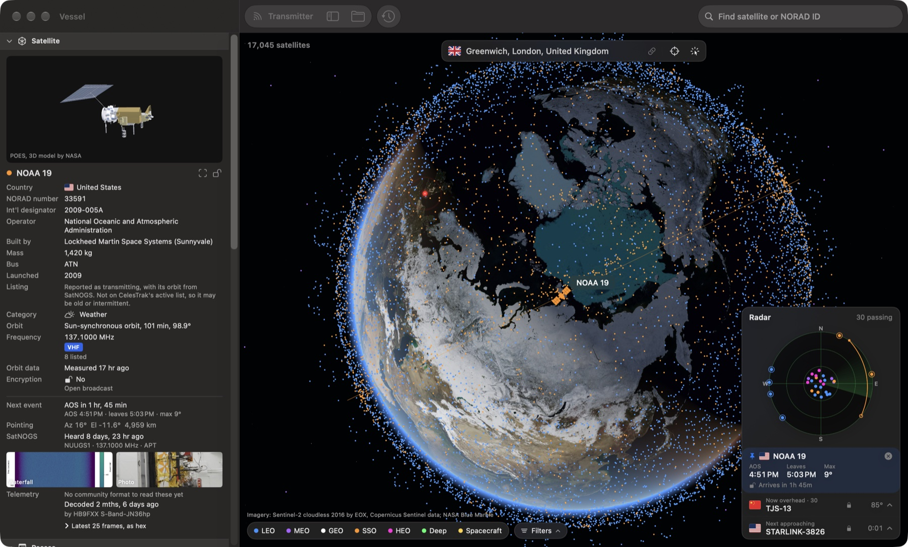

---

## Three tools, one app

Satellite listeners usually keep three programs open side by side. Vessel was built by learning from each of them and bringing what they do into one window.

<table>
<tr>
<td width="33%" valign="top">

**SDR++: the receiver**

A general-purpose SDR receiver: choose your radio, set gain and sample rate, watch the spectrum and waterfall, demodulate FM, AM and SSB.

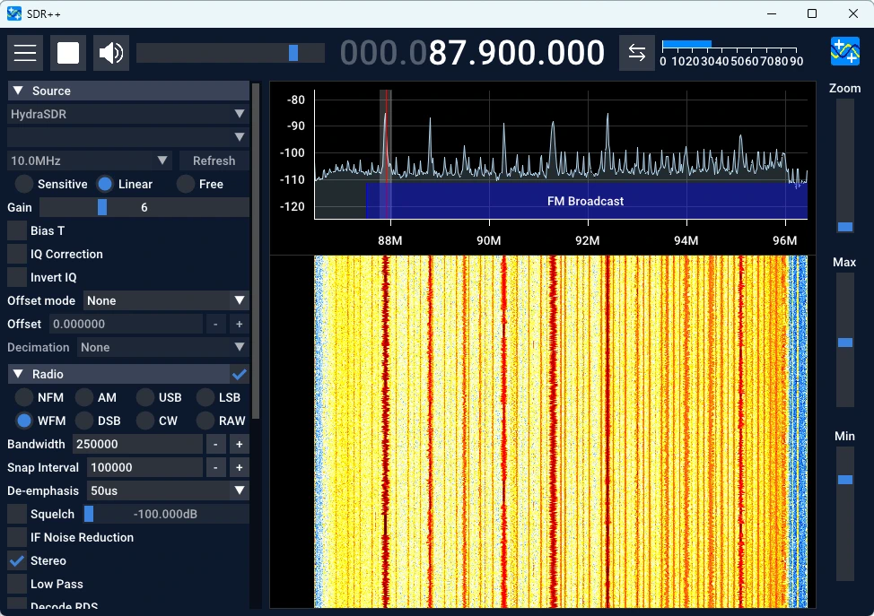

</td>
<td width="33%" valign="top">

**Gpredict: the tracker**

Satellite tracking: a map of where every satellite is, a sky plot of the next pass, and AOS, LOS, azimuth and elevation for your location.

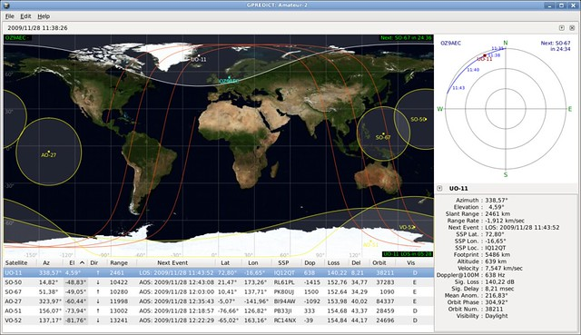

</td>
<td width="33%" valign="top">

**SatDump: the decoder**

Satellite decoding: demodulators, error correction and pipelines that turn a raw signal into weather images, telemetry and data products.

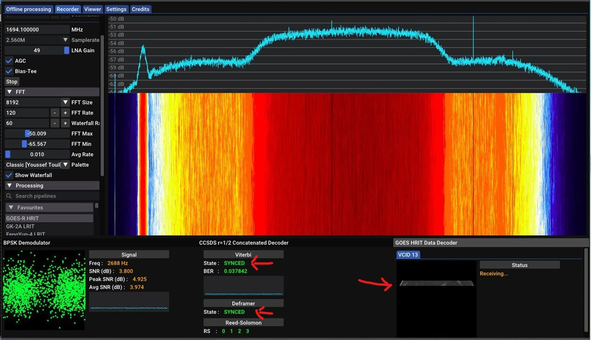

</td>
</tr>
</table>

<p align="center"><b>⬇&nbsp;&nbsp;combined into&nbsp;&nbsp;⬇</b></p>

**Vessel** puts the tracker, receiver and decoder in one window, and connects them. When you lock a satellite, its pass, frequency, decoder and sample rate flow straight into the receiver. When the satellite rises, listening can start by itself, and when it sets, the images and data are saved.

| | Separate programs | Vessel |
|---|---|---|
| Find a satellite | Look it up in the tracker | Click it on the 3D globe, or search by name or NORAD number |
| Know when it passes | Read AOS/LOS in the tracker | Radar, pass list and countdown, worked out for your address |
| Tune the radio | Copy the frequency into the receiver by hand | Tuned automatically from the satellite's published downlinks |
| Correct for Doppler | Link the tracker to the receiver yourself | Followed for you through the pass |
| Decode | Choose a pipeline in the decoder | Chosen for you, per satellite |
| Transmit | A separate radio-control program | Public amateur uplinks only, with safety checks |

SatDump is built into Vessel as its receiving and decoding engine, so there's nothing else to install and no second app to open. SDR++ and Gpredict are not included: Vessel does their jobs in its own code.

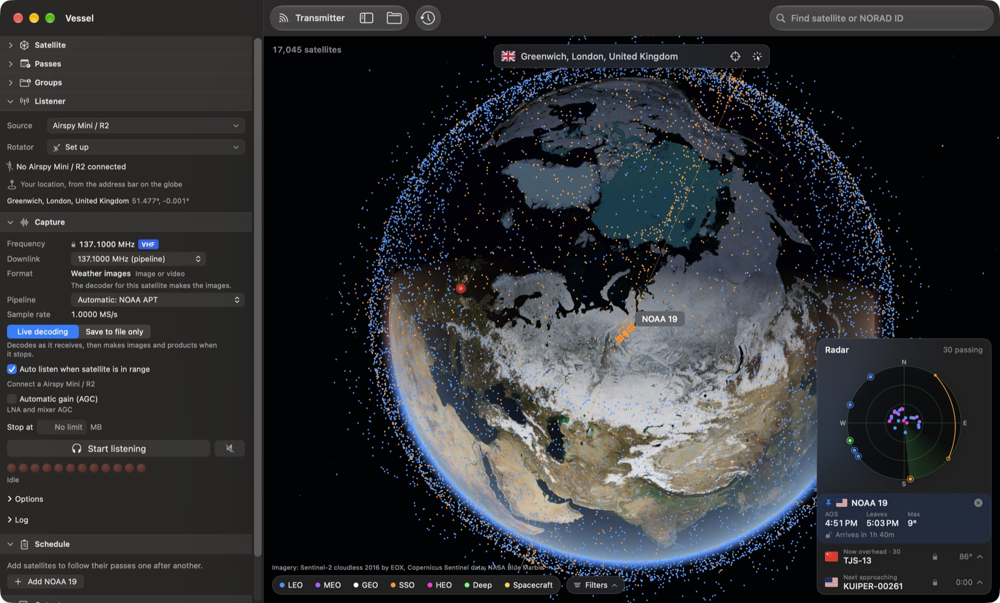

---

## Features

### Satellite tracking, locking and planning

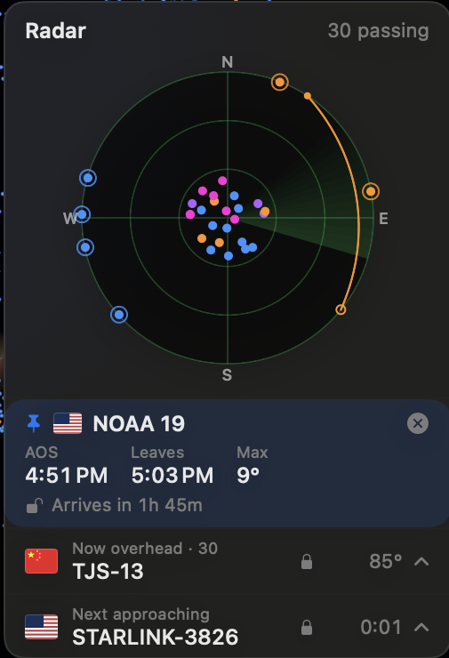

- **3D globe** showing more than 17,000 satellites live, coloured by orbit type (LEO, MEO, GEO, SSO, HEO, deep space and spacecraft), with Sentinel-2 imagery that streams in as you zoom.
- **Lock a satellite** by clicking it, searching for it, or picking it from the radar. The Satellite panel shows its country, operator, builder, mass, launch, category, frequencies with colour-coded band and mode labels, encryption, a 3D model, recent SatNOGS receptions and decoded telemetry.
- **Radar** showing the sky above your address. The locked satellite's path across the sky is drawn in the colour of its orbit type, with a countdown that switches from *Arrives in* to *Leaves in* the moment it rises. *Now overhead* and *Next approaching* both open into lists, and hovering a dot shows the satellite's name and flag.
- **Pass planning** for the next 48 hours, with optional spoken alerts, a contact planner for two stations that can see the satellite at the same time, and a schedule that follows several satellites pass after pass.
- **Filters** by orbit type, category, country, frequency band, signal type and encryption, and groups to keep the satellites you follow together.
- **Lock history** beside the search bar, listing every satellite you've locked with the date and time.
- **Your location** from an address, a click on the globe, Wi-Fi positioning, or a GPS fix taken by scanning GPS satellites with your own SDR.

### A wide range of satellites

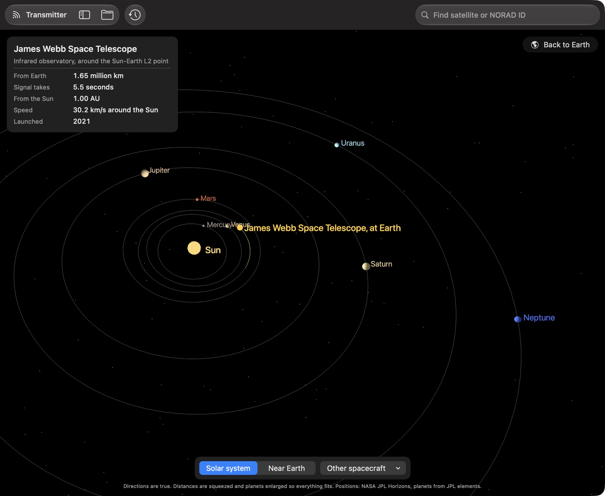

- **Everything in orbit that's publicly tracked:** more than 17,000 active satellites, refreshed from CelesTrak, from low Earth orbit out to geostationary and highly elliptical orbits, including the ISS and the Chinese space station, Starlink, OneWeb, weather, navigation, science and amateur satellites.
- **Newly launched satellites** that SatNOGS already hears, before they have an official catalogue number.
- **Deep-space missions and telescopes** tracked with NASA JPL Horizons, such as the James Webb Space Telescope, Hubble, Voyager 1 and 2, New Horizons, Juno, Europa Clipper, JUICE and Psyche, each shown in its own view of where it is in the solar system.
- **Categories** for every satellite (communications, weather, navigation, Earth observation, science, amateur, space stations and more), with a filter for each.

### Receiver

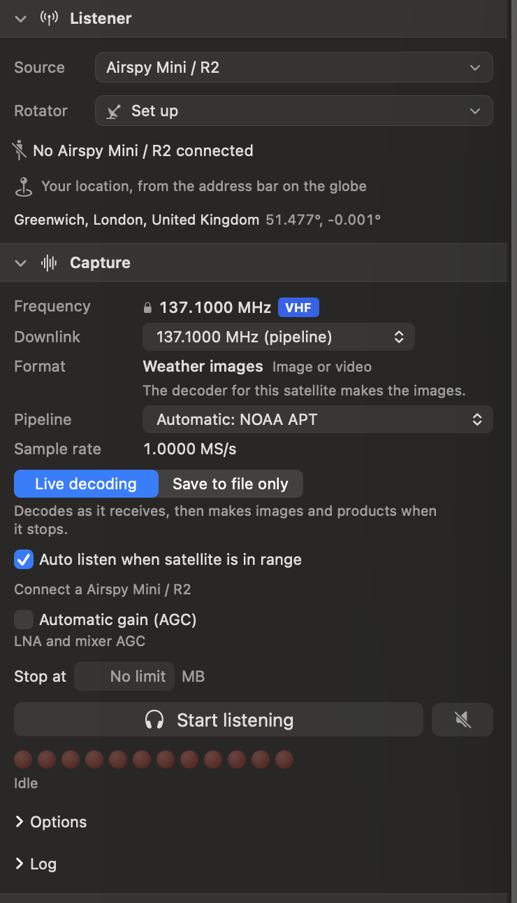

- **Receiver selection.** Vessel detects what's plugged in over USB and lists only that hardware. It recognises RTL-SDR (including Blog V4), Airspy, Airspy HF+, HydraSDR, HackRF, SDRplay, LimeSDR, bladeRF, USRP, PlutoSDR, Fobos and RFNM. It can also listen through public SpyServer stations, so you can try it without any hardware, and opens WebSDR stations in your browser.
- **Configuration.** Frequency, downlink, decoder and sample rate are chosen for each satellite automatically, and can be overridden by hand. Gain is adjustable, with automatic gain where the radio supports it. For RTL-SDR, Vessel reads the tuner chip and offers only the frequencies your dongle can tune.
- **Antenna and rotator.** Vessel can drive an antenna rotator to follow the satellite, wait where it will rise, and park afterwards. Listening through someone else's station uses their antenna, and their antenna details are shown.
- **Spectrum and waterfall** with labelled signals and a signal meter.
- **Live decoding or save to file.** Decode as the signal arrives and get weather images, SSTV pictures, packet messages and telemetry, or save the raw signal to process later. *Auto listen* starts when the satellite rises and stops when it sets.
- **Scan** for satellites with no published frequency, checking candidate signals against the Doppler shift the orbit predicts.

### Online receiver network

No radio of your own? Vessel can listen through hundreds of public SpyServer stations around the world, with WebSDR stations opening in your browser.

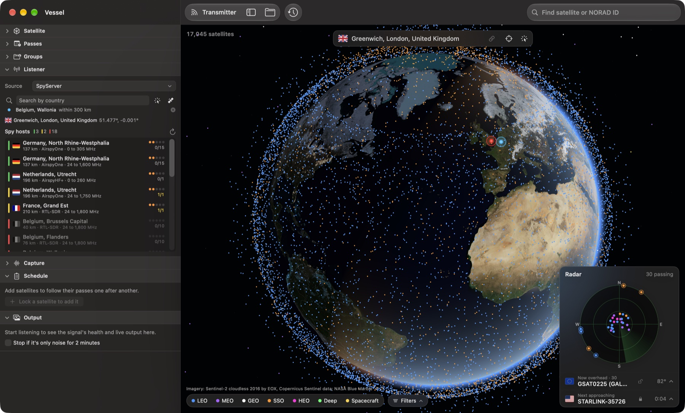

- **The full directory** is loaded live, with each station's location, frequency range, antenna and how many people are using it.
- **Choose by place:** search by country, or click a region on the globe to list the stations there.
- **Choose by satellite:** list only the stations that can hear the locked satellite, with when it will next pass over each of them.
- **Live status:** each station is checked as you browse and marked as available, busy or offline. The one you pick shows its connection strength.
- Tuning, sample rate and gain follow the satellite automatically, just as with a radio of your own.

### Live satellite information

Vessel combines several public databases and APIs, so each satellite comes with as much information as is published:

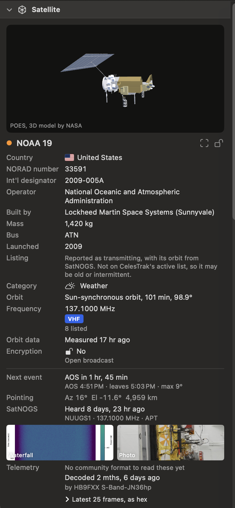

| What | Where it comes from |
|---|---|
| Orbits and the satellite catalogue | CelesTrak |
| Owner country | CelesTrak SATCAT |
| Operator, builder, mass and bus | GCAT by Jonathan McDowell |
| Downlink and uplink frequencies, recent receptions, pictures, telemetry | SatNOGS DB and Network |
| Amateur frequencies and live operating reports | AMSAT and the JE9PEL satellite index |
| Deep-space positions | NASA JPL Horizons |
| Decoder updates | SatDump's published decoder definitions |

Everything is cached on your Mac and refreshed politely, at the intervals each service asks for. Satellites with missing details link to Orbital Radar for a look-up in your browser.

### Transmitter

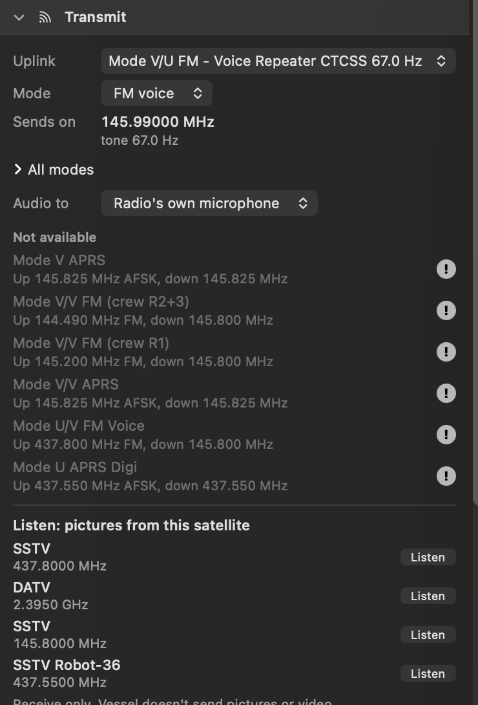

- **Public amateur uplinks only.** Frequencies come from SatNOGS and AMSAT listings of active amateur uplinks inside the amateur satellite bands. You can't type in a frequency, and command, telemetry and beacon links are never offered.
- **Modes:** FM voice with CTCSS, SSB voice, CW, APRS, packet at 1200 and 9600 baud, PSK31, RTTY, FT8 and FT4. Each uplink offers only the modes it can carry.
- **Radios** found over USB, or any radio Hamlib's `rigctld` can control.
- **Safety first.** Vessel transmits only while you hold the button, and only once you've entered your callsign and confirmed that you hold an amateur licence. It stops on release, timeout, low elevation, stale orbit data, a lost radio link or a change of satellite. If the app crashes, a guard process unkeys the radio. Every transmission is logged.
- **Live AMSAT reports** for each satellite's modes, a contact planner and a contact log.

---

## Tested hardware

Vessel has been tested so far with the most widely available SDR dongles:

- **RTL-SDR** (RTL2832U with R820T/R828D tuners, including RTL-SDR Blog V4)
- **Airspy** (Mini, R2)

The other radios above are recognised and configured, but haven't been tested on real hardware yet. Reports from owners are very welcome. Transmit hasn't been tested with a real radio yet, so test into a dummy load first.

## Install

1. Download **Vessel-1.0.0-macOS-arm64.zip** from the [latest release](https://github.com/afterplanet/Vessel/releases/latest).
2. Unzip it and move **Vessel.app** to your Applications folder.
3. Open it. Vessel isn't notarised by Apple yet, so the first time macOS will refuse to open it. Go to **System Settings > Privacy & Security**, scroll down and click **Open Anyway**.

The prebuilt app needs a Mac with Apple silicon and **macOS 27.2 or later**. On older versions of macOS, build Vessel from source instead.

## Build from source

You'll need macOS 14 or later, Xcode and [Homebrew](https://brew.sh). The app you build runs on the version of macOS you build it on, or later.

1. Build the receiving engine once. This compiles SatDump and the radio libraries from source into `vendor/satdump`, which the app build then seals inside Vessel.app. The first run takes a while:

   ```bash
   tools/build_satdump.sh
   ```

2. Optional: to find your position by GPS, build GNSS-SDR once. It's compiled from source into `vendor/gnss-sdr`:

   ```bash
   tools/build_gnss_sdr.sh
   ```

3. Build and open the app:

   ```bash
   ./build_app.sh
   ```

   ```bash
   open Vessel.app
   ```

Run the tests with `swift test`. More detail on how each part works is in the [user guide](docs/GUIDE.md).

## Contributing

Download it, try it, and let us know how it goes. Vessel is version 1, so issues are expected, and every bug report, idea and piece of feedback helps.

- **Found a bug?** [Open an issue](https://github.com/afterplanet/Vessel/issues) with what you did, what you expected, your radio and your macOS version.
- **Have an idea?** Open an issue to talk it through.
- **Want to help?** Pull requests are welcome. Reports from owners of radios other than RTL-SDR and Airspy are especially useful.

Contributions are accepted under the [Contributor Licence Agreement](CLA.md). See [CONTRIBUTING.md](CONTRIBUTING.md) for details.

## Credits

Vessel stands on the work of many people and projects. Thank you to all of them.

**Software behind Vessel**

- [SatDump](https://github.com/SatDump/SatDump) by Aang23 and contributors (GPL-3.0). Vessel's receiving and decoding engine: it's built from source into Vessel.app and runs as a background program. Its licence and the exact source version are in `Contents/Resources/Engine` inside the app.
- [SDR++](https://github.com/AlexandreRouma/SDRPlusPlus) by Alexandre Rouma, for the receiver experience. No SDR++ code is used.
- [Gpredict](https://github.com/csete/gpredict) by Alexandru Csete (OZ9AEC), for satellite tracking. No Gpredict code is used.
- Screenshots of SDR++, Gpredict and SatDump belong to their respective projects.

**Data and APIs**

- [AMSAT](https://www.amsat.org): satellite status reports (CC BY 4.0) and the amateur satellite frequency index maintained by JE9PEL, KF0IA and SatNOGS.
- [SatNOGS](https://satnogs.org) by the Libre Space Foundation: transmitters, receptions and telemetry. Telemetry formats come from satnogs-decoders (AGPL-3.0), downloaded at runtime.
- [CelesTrak](https://celestrak.org) by T.S. Kelso: orbital elements and the satellite catalogue.
- [GCAT](https://planet4589.org) by Jonathan McDowell: operators, builders, mass and bus.
- Satellite Database, Space Geodesy group, ETH Zurich (satdb.ethz.ch): the Starlink downlink band.
- NASA JPL Horizons: spacecraft positions.

**Libraries, imagery and models**

- SGP4: David Vallado's reference code, via python-sgp4 (MIT).
- [GNSS-SDR](https://gnss-sdr.org) (GPL-3.0): GPS positions. It ships inside the app and runs as a separate program.
- ft8_lib by Kārlis Goba (MIT): FT8 and FT4 encoding.
- ssdv by Philip Heron (GPL-3.0): SSDV picture packets.
- Draco by Google (Apache-2.0): 3D mesh decoding, trimmed to decoding.
- Yams (MIT): YAML parsing.
- flag-icons (MIT): country flags.
- Sentinel-2 cloudless 2016 by EOX IT Services (https://s2maps.eu), containing modified Copernicus Sentinel data 2016 & 2017 (CC BY 4.0).
- NASA Blue Marble and the NASA/GSFC CGI Moon Kit (public domain). Night and water maps via three-globe (MIT).
- Natural Earth (public domain): borders. GeoNames (CC BY 4.0): place names.
- [NASA 3D Resources](https://github.com/nasa/NASA-3D-Resources): satellite models, downloaded when needed. See NASA's [usage guidelines](https://www.nasa.gov/nasa-brand-center/images-and-media/).
- Community 3D models (CC BY 4.0): Starlink by Malacodart, Tiangong by w29572227, and a generic satellite by DjalalxJay. Full credits are in `Sources/Vessel/Resources/models/CREDITS.txt`.

## Licence

Copyright © 2026 Ryvan Prabhu. Vessel is **dual-licensed**:

- **Open source** under the [GNU General Public License v3.0](LICENSE). Use it, study it, change it and share it freely, for personal use, learning and experiments. Anything you distribute that's built from Vessel must stay open source under the same licence.
- **Commercial licence** for anyone who wants to use Vessel's code in closed-source software. Contact [@afterplanet](https://github.com/afterplanet) to ask.

Third-party GPL components (SatDump, GNSS-SDR and ssdv) stay under their own licences. See [LICENSING.md](LICENSING.md) for the details.

## Author

Made by **Ryvan Prabhu** ([@afterplanet](https://github.com/afterplanet)).
